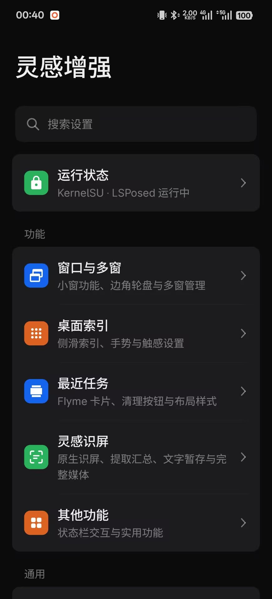
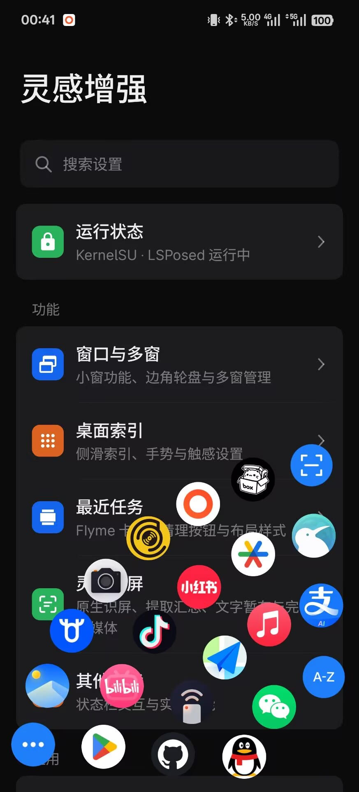
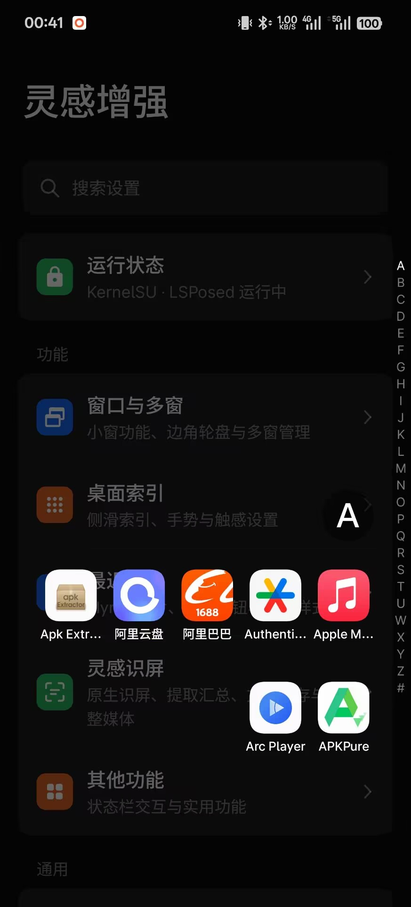
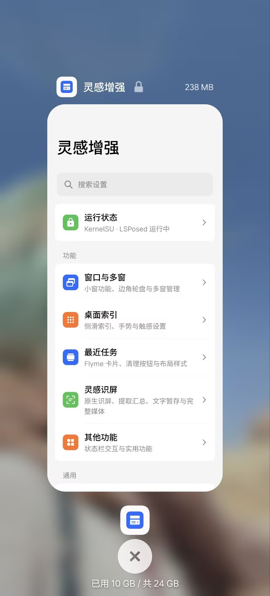
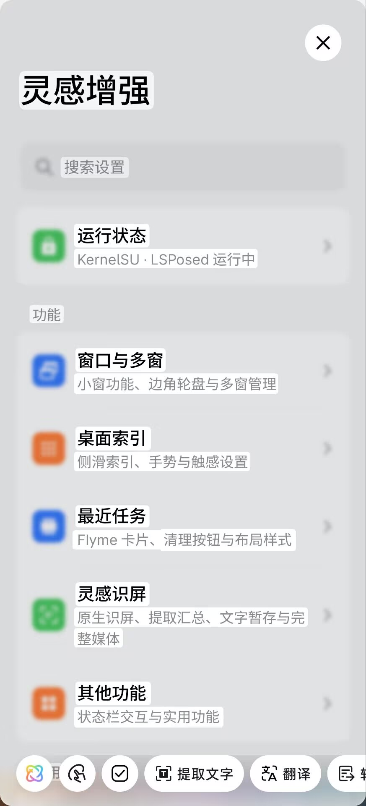

+++
authors = ["canxin"]
title = "灵感增强：为 ColorOS 添一份顺手"
description = "为 ColorOS 带来 Flyme 风格的边角轮盘、最近任务与窗口交互，搭配桌面索引、识屏和长按内容提取。"
date = 2026-10-11
updated = 2026-10-11
slug = "inspiration-enhance"
[taxonomies]
tags = ["ColorOS", "Android", "Flyme", "LSPosed", "Root"]
[extra]
toc = true
toc_inline = true
styles = ["css/inspiration-enhance.css"]
+++

灵感增强是我为 ColorOS 做的一款系统增强应用，将 Flyme 风格的交互融入日常使用，围绕窗口与多窗、边角轮盘、桌面索引、最近任务和内容提取，提供更方便的操作方式。

目前最新正式版本为 **0.1.1**。安装包和更新说明可以在[最新 Release](https://github.com/canxin121/InspirationEnhance/releases/latest) 查看，也可以[直接下载 APK](https://github.com/canxin121/InspirationEnhance/releases/latest/download/InspirationEnhance.apk)。

> 使用需要 **Root 与 LSPosed**。目前面向 ColorOS 15 / 16，并加入一加 15 的 ColorOS 17 适配；具体支持情况见下方安装说明。

## 功能入口

<figure class="inspiration-screenshot">
  
  <figcaption>图一：应用首页，各项功能都有独立入口。</figcaption>
</figure>

可以在首页按自己的习惯调整各项功能。运行状态集中显示手机型号、模块和相关系统应用的版本等信息，支持一键复制；日志中心和应用更新也有各自的入口，方便排查问题和获取新版本。

## 边角轮盘

<figure class="inspiration-screenshot">
  
  <figcaption>图二：从屏幕底角滑出，快速打开常用应用。</figcaption>
</figure>

从屏幕底角滑动即可呼出轮盘，快速打开常用应用和快捷功能。轮盘内容、层数和左右布局都可以自由调整，在布局页面选好并保存后即可使用，让常用操作更容易单手完成。

## 桌面索引

<figure class="inspiration-screenshot">
  
  <figcaption>图三：通过字母索引，快速查找和打开应用。</figcaption>
</figure>

从桌面边缘侧滑呼出应用索引，再通过字母快速定位应用。安装的应用比较多时，可以少翻几页桌面，也不用记住每个图标放在哪里。

## 最近任务

<figure class="inspiration-screenshot">
  
  <figcaption>图四：最近任务卡片、圆形清理按钮与内存使用情况。</figcaption>
</figure>

最近任务采用 Flyme 风格的卡片布局和清理动效，圆形清理按钮下方可以查看手机的内存占用与总量。

应用菜单中还提供 **强行停止**。授予 Root 权限后即可使用；停止应用后，对应任务会以划出动画从列表中移除。

## 灵感识屏与长按提取

<figure class="inspiration-screenshot">
  
  <figcaption>图五：识屏结果页，可以选择并提取当前页面中的内容。</figcaption>
</figure>

灵感识屏基于系统原生识屏能力，方便查看和提取当前页面中的文字、图片与视频等内容。

此外，在支持的第三方应用中，还可以开启 **长按内容提取**，长按图片、表情等内容后调出提取菜单，快捷复制、保存或分享。使用前需要在 LSPosed 中勾选对应应用。

菜单支持两种操作方式：抬手后直接点击按钮，或保持按住，滑动到按钮上选中，**松手后执行**。滑出按钮后松手则取消。没有滑入提取按钮时，仍保留应用自己的长按操作。

菜单底部的短横条可以拖动，方便移开遮挡。不同应用版本和页面的支持情况有所不同，抖音、微信、QQ 中的部分图片、动态表情或视频仍可能无法获取源文件。

## 窗口与其他功能

除了上面几项，灵感增强还提供：

- **窗口与多窗**：Flyme 风格的小窗、迷你窗快捷菜单、联系人头像显示和小窗数量设置。
- **状态栏点按回顶**：轻点状态栏，让支持的当前页面回到顶部。
- **日志中心**：集中管理日志设置、查看本地日志文件和导出日志。

这些选项都可以在应用内按需调整。

## 安装与启用

使用灵感增强需要设备具备 Root 权限，并安装 LSPosed，可使用 Magisk、KernelSU 等 Root 管理器。

目前面向 **ColorOS 15 / 16**。ColorOS 17 当前针对一加 15 国行 **17.0.0.102 / 17.0.0.105** 完成系统原包适配与自动化检查，仍需真机反馈。功能可用性会随机型、系统和第三方应用版本有所不同。

1. 从[最新 Release](https://github.com/canxin121/InspirationEnhance/releases/latest) 下载并安装「灵感增强」APK。
2. 在 LSPosed 中启用模块，勾选系统框架、系统界面、正在使用的系统桌面及原生识屏应用；需要长按提取的第三方应用也要勾选。
3. 打开「灵感增强」，在「运行状态」中授权 Root，再按自己的习惯调整功能。
4. 首次启用或更新后重启手机，使模块生效。之后调整设置，按页面提示使用「应用更改」。

## 更新与反馈

已有版本可以直接覆盖安装，原有设置会保留。应用默认自动检查更新，发现新版本后会在首页显示更新入口，也可以在 **关于灵感增强 → 应用更新** 中手动检查和下载安装。

遇到问题时，可以在运行状态页复制当前信息，并附上复现步骤、截图或录屏提交反馈。需要日志时，在 **日志中心 → 输出与保留** 开启 **保留到本地文件**，复现问题后再导出。

GitHub 仓库用于公开发布安装包、更新说明和收集反馈，源码目前未公开。

- [GitHub 仓库](https://github.com/canxin121/InspirationEnhance)
- [最新 Release](https://github.com/canxin121/InspirationEnhance/releases/latest)
- [APK 直接下载](https://github.com/canxin121/InspirationEnhance/releases/latest/download/InspirationEnhance.apk)
- [反馈问题](https://github.com/canxin121/InspirationEnhance/issues)
